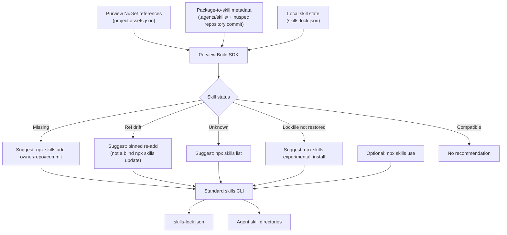

# Agent Skills

[Agent Skills](https://skills.sh/) are folders of `SKILL.md` guidance that coding agents load on
demand. Purview publishes them in the standard format and installs them with the standard
[`skills` CLI](https://skills.sh/) — `npx skills add`, `npx skills update`, `npx skills remove`.

`Purview.BuildSdk` deliberately does **not** reimplement any of that. It knows one thing the CLI
cannot know: which skills are relevant to the NuGet packages a project actually references, and at
which version. So the SDK **discovers and recommends**, and the CLI **installs**.

> The SDK recommends commands. It never runs them. Nothing on this page installs, updates or removes
> a skill as a side effect of a restore, a build, a design-time build or a test run.

## The boundary



| Component | Owns |
| -- | -- |
| Purview libraries | Their API guidance, authored as skills in their own repository |
| Skill publication | Making those skills reachable by `npx skills add` |
| Package-to-skill metadata | Which package ships which skills, and at which commit |
| Purview Build SDK | Reading package references, evaluating local state, recommending commands |
| Skills CLI | Installing, updating, removing, source tracking, agent-specific destinations |
| Consuming repository | Its installed skills and its `skills-lock.json` |

## Publication

Skills are authored at the **repository root**, in `skills/<name>/SKILL.md`, and published two ways
from that one copy:

- **To the skills CLI**, which clones the git repository and discovers a root `skills/` folder.
- **To the NuGet package**, where `PurviewPackRepositorySkills` packs them into the package's
  `.agents/skills/`, which the [agent folder](Agent-Folder.md) mirror copies into a consuming
  repository's `.agents/`.

Both routes matter: the mirrored `.agents/` folder is gitignored in every consuming repository, so
it is absent from a clone and cannot serve the CLI.

```bash
npx skills add purview-dev/build-sdk                    # every skill
npx skills add purview-dev/build-sdk --skill tunit-filtering
npx skills add purview-dev/build-sdk --list             # see what is there, install nothing
```

Skills live **alongside the library they describe**, in that library's repository, rather than in
one central skills repository. That is what makes version compatibility exact: a package and its
skills are built from the same commit, so the package itself carries the mapping (see below). A
central repository would have to re-derive that association, and would drift from the libraries it
documents.

`PurviewSkillsToPack` narrows which skills a given project packs, so a repository producing several
packages ships each skill with the library it belongs to rather than duplicating all of them
everywhere.

## Authoring

`npx skills init <name>` scaffolds a skill; move it under `skills/<name>/` and adapt the frontmatter
to Purview conventions. `ValidatePurviewSkills` then checks it at pack time, and
`IncludePurviewSkillsInPackage` depends on it — so a malformed skill fails the build of the
repository that owns it rather than shipping a skill the CLI silently skips. It checks that:

- every folder under the skills root has a `SKILL.md`,
- that file opens with YAML frontmatter carrying `name` and `description`,
- `name` matches the folder name, because the CLI installs by frontmatter name while a human reads
  the folder name, and
- every `references/...` path the body links to exists.

Failures are reported as `PRSKL0005`. Prose quality is deliberately not checked: a build can only
check that a skill is well formed.

Keep shared engineering guidance in one skill and link to it, rather than copying it into every
library's skill.

## How the SDK maps a package to its skills

There is **no custom `skills.json` manifest**. A package that ships skills already carries both
halves of the mapping, and the SDK reads them:

| Half | Source |
| -- | -- |
| Which skills this package ships | `.agents/skills/<name>/` inside the restored package |
| Which git repository and commit built them | the nuspec's `<repository url="…" commit="…" />`, written by SourceLink |

Both are local to the restored package, so resolution is offline and triggers no restore of its own.
A package whose nuspec has no GitHub repository URL, or no commit, **cannot** be pinned; it is
reported rather than installed from a guessed default branch.

## Recommendations

Recommendations are the one part of this feature that runs during an ordinary build. They read the
restore graph and the CLI's own `skills-lock.json`, both local; they recommend commands and never
run them; and they never fail a build.

```bash
dotnet msbuild <project> -t:RecommendPurviewSkills   # explicit, always reports
```

Every skill a referenced package ships is classified:

| State | Diagnostic | Severity | Recommendation |
| -- | -- | -- | -- |
| Installed at the referenced commit | *(none)* | — | — |
| Not installed | `PRSKL0010` | Warning | `npx skills add "<owner/repo>#<commit>" --skill …` |
| Installed from a different ref | `PRSKL0011` | Warning | pinned re-add at the referenced commit |
| Compatibility unverifiable | `PRSKL0012` | Message | `npx skills list` |
| From a repository no longer referenced | `PRSKL0013` | Message | `npx skills remove "<name>"` |
| Lockfile present, nothing restored | `PRSKL0014` | Message | `npx skills experimental_install` |

Severity splits on what a developer can act on. A missing or drifted skill is one command away, so
it is a warning. An unverifiable one usually is not — a package without SourceLink metadata cannot
be pinned by anybody — so it stays a message and can never break a build that treats warnings as
errors. Warnings are suppressible in the usual way:

```xml
<PropertyGroup>
  <MSBuildWarningsAsMessages>$(MSBuildWarningsAsMessages);PRSKL0010;PRSKL0011</MSBuildWarningsAsMessages>
</PropertyGroup>
```

**Unverifiable** (`PRSKL0012`) covers three distinct cases, all of which mean "there is nothing
reliable to compare against": the package cannot be pinned at all; the skill was installed without a
ref; or a skill of the same name is installed from some other repository. The last is never treated
as drift and never overwritten — somebody installed it deliberately.

**Orphan detection** (`PRSKL0013`) is **owner-scoped on purpose**. A lockfile cannot record who
asked for an entry, so only an entry under an owner the project *does* reference, but from a
repository it *no longer* references, is reported. A skill from any other owner is the developer's
own and is never mentioned. This is a heuristic, which is why it is a message and why nothing is
ever removed automatically.

### Staying quiet

| Situation | Behaviour |
| -- | -- |
| Everything installed and compatible | No output at all |
| Design-time build (`DesignTimeBuild=true`) | Skipped |
| CI build (`ContinuousIntegrationBuild`, `TF_BUILD`, `GITHUB_ACTIONS`, `CI`) | Skipped unless opted in |
| Non-default target framework in a multi-targeting build | Skipped |
| Same state as last reported | Skipped |

The last one is deduplication. A solution has many projects sharing one repository, and a rebuild
changes nothing, so a fingerprint of the reported state is kept in
`<repo root>/.purview/skill-recommendations.cache`. The same advice is printed once, and again only
when the state it describes actually changes. The explicit `-t:RecommendPurviewSkills` target
ignores the stamp and always answers.

### Configuration

| Property | Default | Description |
| -- | -- | -- |
| `EnablePurviewSkillRecommendations` | `true` | Reports skill state after an ordinary build. |
| `PurviewSkillRecommendationsInCI` | `false` | Set `true` to report on CI builds too. |
| `PurviewSkillRecommendationStampPath` | `<repo root>/.purview/skill-recommendations.cache` | Overrides the deduplication stamp. |
| `PurviewSkillsLockFile` | `<repo root>/skills-lock.json` | Overrides where the CLI's lockfile is read from. |
| `PurviewSkillsAgents` | `*` | Agents named in the recommended install command. |

## Version compatibility

NuGet package versions and skill versions evolve independently, so a project on an older library
must not be advised to install skills that describe a newer API.

The mechanism is a **commit pin**, and it is exact by construction. The nuspec of the *restored
package version* names the commit it was built from, and the CLI accepts `owner/repo#<ref>` and
records that ref in `skills-lock.json`. Comparing the two is the whole compatibility check:

```text
package Purview.Example 1.2.3  →  nuspec commit  0123456…
skills-lock.json: purview-alpha →  ref           aaaaaaa…   ← drift
```

This is why **`npx skills update` is not recommended on drift**. `update` installs the newest
published skill, which is correct only when the newest skill happens to describe the referenced
package version — something that cannot be known offline, and that is false for any project not on
the latest package. `PRSKL0011` therefore names the referenced package's own commit instead:

```bash
npx skills add "purview-dev/purview-example#0123456789abcdef0123456789abcdef01234567" \
  --skill "purview-alpha" --agent "*" -y
```

`npx skills update` remains the right command when the intent is to track the latest published
skills — for example right after upgrading the package reference, once the new version is restored
and the SDK reports the state as compatible again.

> Note the repeated `--skill` flag. The CLI does not split a comma-separated value: given one, it
> matches nothing and reports "No matching skills found".

## The lockfile

`skills-lock.json` is the CLI's own record of what is installed and where it came from. The SDK
reads it and introduces **no competing lockfile**. Reading it rather than parsing CLI output is
deliberate: the JSON listing (`npx skills list --json`) is machine-readable but omits the `ref`, and
the ref is the entire question. The lockfile carries it, and reading a file costs no Node tooling —
which is what keeps recommendations working on a machine that can build .NET but has no Node.

A lockfile is a record of an install, not proof of one: a fresh clone carries a committed
`skills-lock.json` and no installed skills at all. The SDK detects that case — a lockfile with no
agent skill directory anywhere at the repository root — and reports `PRSKL0014`:

```bash
npx skills experimental_install   # restore everything in skills-lock.json
```

This command is **experimental**, so it is suggested and never required, never invoked
automatically, and always offered with the supported fallback (`npx skills add`). Prefer a stable
restore command if the CLI gains one. The detection looks for any root dot-folder containing a
`skills` folder rather than hard-coding agent directories, which belong to the CLI and change
independently of this SDK; the SDK's own `.agents/` mirror is excluded.

## Installing from the SDK

Installation is **explicit**. Neither target has `BeforeTargets`/`AfterTargets`:

```bash
dotnet msbuild <project> -t:ListPurviewSkills      # diagnostics only, installs nothing
dotnet msbuild <project> -t:InstallPurviewSkills   # delegates to the skills CLI
```

`InstallPurviewSkills` shells out to the CLI rather than reimplementing it, because the CLI owns the
agent-specific destinations and their discovery conventions — which differ per agent and change
independently of this SDK — and owns `skills-lock.json`.

To install a Purview skill the project has no `PackageReference` for, name the source directly. The
caller owns the ref in that case; append `#<ref>` to pin it:

```bash
dotnet msbuild <project> -t:InstallPurviewSkills -p:PurviewSkillsSource=purview-dev/engineering-playbook
```

### Detecting the CLI

The CLI is Node tooling, so it is not guaranteed on a machine that can build .NET.
`DetectPurviewSkillsCli` probes `PATH` for `skills` first, then `npx`, honouring `PATHEXT` on
Windows where both are `.cmd` shims.

- `skills` on `PATH` is used as-is — no download, works offline.
- Otherwise `npx -y skills@1`, pinned to a major so a future breaking release cannot change what the
  target does.
- Neither found is `PRSKL0004`, naming the fix (install Node, or `npm install -g skills`) rather
  than surfacing a raw `'npx' is not recognized`.
- `PurviewSkillsCommand` overrides the launcher entirely and skips detection.

`ListPurviewSkills` and `RecommendPurviewSkills` **never** error on a missing CLI. Resolving,
evaluating and reporting need no Node tooling at all.

## One-off use

To consult a skill once without installing it:

```bash
npx skills use purview-dev/build-sdk@tunit-filtering | claude
```

This is a good fit for a one-time operation. It is not a substitute for installing the skills a
project needs throughout development, and the SDK's recommendations do not suggest it in place of
`add`.

## npm distribution

`npx skills experimental_sync` discovers skills shipped inside npm packages, by reading
`node_modules`.

**Purview does not use it, and should not.** Purview libraries ship as NuGet packages; their skills
are already carried inside those packages and mirrored into `.agents/`, and are already installable
from git by `npx skills add`. Publishing a parallel npm package would mean:

- a second release pipeline to version, publish and keep in step with the NuGet one,
- a `package.json` and a `node_modules` restore in .NET repositories that otherwise need neither,
  purely to obtain documentation, and
- two sources of truth for the same skill, with no mechanism tying the npm version to the NuGet
  version — losing exactly the commit-pinned compatibility described above.

The git source the CLI already supports delivers the same skills with none of that. `experimental_sync`
remains useful to a repository that independently consumes npm packages shipping skills; it is simply
not a Purview distribution channel. Revisit only if Purview starts shipping npm packages for their
own sake.

## Supported CLI commands

Verified against the `skills` CLI v1.

| Command | Purpose | Role here |
| -- | -- | -- |
| `npx skills add <source>` | Install skills | The installation workflow; accepts `owner/repo#<ref>` |
| `npx skills list` | List installed skills | Diagnostics; `--json` is machine-readable but omits `ref` |
| `npx skills find [query]` | Search for skills | Discovery fallback where no package mapping exists |
| `npx skills update` | Update to latest | Correct only when latest matches the referenced package |
| `npx skills remove` | Remove skills | Developer-managed |
| `npx skills use <source>@<skill>` | Use without installing | One-off guidance |
| `npx skills experimental_install` | Restore from `skills-lock.json` | Optional bootstrap; experimental |
| `npx skills init [name]` | Scaffold a skill | Authoring |
| `npx skills experimental_sync` | Sync from `node_modules` | Not used by Purview — see above |

## Diagnostics

| Code | Meaning |
| -- | -- |
| `PRSKL0001` | `project.assets.json` is missing; run `dotnet restore` first |
| `PRSKL0002` | A package ships skills but carries no pinnable git identity |
| `PRSKL0004` | Neither `skills` nor `npx` was found on `PATH` |
| `PRSKL0005` | An authored skill is malformed |
| `PRSKL0010` | Skills a referenced package ships are not installed |
| `PRSKL0011` | Installed skills are pinned to a different ref than the referenced package |
| `PRSKL0012` | Compatibility cannot be verified |
| `PRSKL0013` | A skill is installed from a repository no longer referenced |
| `PRSKL0014` | `skills-lock.json` exists but no skills have been restored |

## See also

- [Agent Folder](Agent-Folder.md) — how `.agents/**` is mirrored into a consuming repository
- [Configuration Reference](Configuration-Reference.md)
- [Packaging](Packaging.md)
