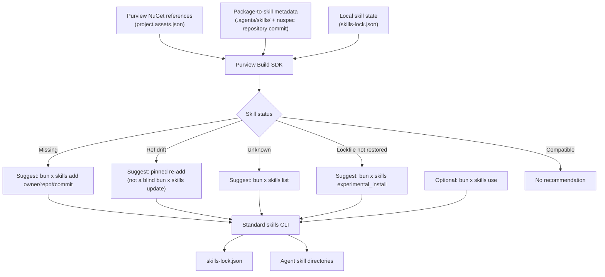

# Agent Skills

[Agent Skills](https://skills.sh/) are folders of `SKILL.md` guidance that coding agents load on
demand. Purview publishes them in the standard format and installs them with the standard
[`skills` CLI](https://skills.sh/) — `bun x skills add`, `bun x skills update`, `bun x skills remove`.

`Purview.BuildSdk` deliberately does **not** reimplement any of that. It knows one thing the CLI
cannot know: which skills are relevant to the NuGet packages a project actually references, and at
which version. So the SDK **discovers and recommends**, and the CLI **installs**.

> The reporting targets recommend commands and never run them. Only `InstallPurviewSkills` and
> `UpdatePurviewSkills`, invoked by name, run the CLI, and only `FixPurviewSkills` deletes anything.
> Nothing on this page installs, updates or removes a skill as a side effect of
> a restore, a build, a design-time build or a test run.

## The boundary



| Component | Owns |
| -- | -- |
| Purview libraries | Their API guidance, authored as skills in their own repository |
| Skill publication | Making those skills reachable by `bun x skills add` |
| Package-to-skill metadata | Which package ships which skills, and at which commit |
| Purview Build SDK | Reading package references, evaluating local state, recommending commands |
| Skills CLI | Installing, updating, removing, source tracking, agent-specific destinations |
| Consuming repository | Its installed skills and its `skills-lock.json` |

## Publication

Skills are authored at the **repository root**, in `skills/<name>/SKILL.md`, and published through
the skills CLI, which clones the git repository and discovers a root `skills/` folder.

That is the only route. No NuGet package carries skills: a package holds .NET artifacts, and the
CLI delivers skills from git.

```bash
bun x skills add purview-dev/build-sdk                    # every skill
bun x skills add purview-dev/build-sdk --skill purview-buildsdk-testing
bun x skills add purview-dev/build-sdk --list             # see what is there, install nothing
```

Skills live **alongside the library they describe**, in that library's repository, rather than in
one central skills repository. A central repository would have to re-derive which skill belongs to
which library, and would drift from the libraries it documents.

## Authoring

`bun x skills init <name>` scaffolds a skill; move it under `skills/<name>/` and adapt the frontmatter
to Purview conventions. `ValidatePurviewSkills` runs `BeforeTargets="Pack"`, so a malformed skill
fails the build of the repository that owns it rather than reaching the CLI, which would silently
skip it. It checks that:

- every folder under the skills root has a `SKILL.md`,
- that file opens with YAML frontmatter carrying `name` and `description`,
- `name` matches the folder name, because the CLI installs by frontmatter name while a human reads
  the folder name, and
- every `references/...` path the body links to exists.

Failures are reported as `PRSKL0005`. Prose quality is deliberately not checked: a build can only
check that a skill is well formed.

Keep shared engineering guidance in one skill and link to it, rather than copying it into every
library's skill.

## How the SDK maps a package to its skills

There is **no custom `skills.json` manifest**. A package that ships skills already carries both
halves of the mapping, and the SDK reads them:

| Half | Source |
| -- | -- |
| Which skills this package ships | `.agents/skills/<name>/` inside the restored package |
| Which git repository and commit built them | the nuspec's `<repository url="…" commit="…" />`, written by SourceLink |

Both are local to the restored package, so resolution is offline and triggers no restore of its own.
A package whose nuspec has no GitHub repository URL, or no commit, **cannot** be pinned; it is
reported rather than installed from a guessed default branch.

## Recommendations

Recommendations read the restore graph and the CLI's own `skills-lock.json`, both local; they
recommend commands and never run them; and `RecommendPurviewSkills` never fails a build. They run
only when a target is named — never during an ordinary build (see [When it runs](#when-it-runs)).

```bash
dotnet msbuild <project> -t:RecommendPurviewSkills   # explicit, always reports
```

Every skill a referenced package ships is classified:

| State | Diagnostic | Severity | Recommendation |
| -- | -- | -- | -- |
| Installed at the referenced commit | *(none)* | — | — |
| Not installed | `PRSKL0010` | Warning | `bun x skills add "<owner/repo>#<commit>" --skill …` |
| Installed from a different ref | `PRSKL0011` | Warning | pinned re-add at the referenced commit |
| Compatibility unverifiable | `PRSKL0012` | Message | `bun x skills list` |
| From a repository no longer referenced | `PRSKL0013` | Message | `bun x skills remove "<name>"` |
| Lockfile present, nothing restored | `PRSKL0014` | Message | `bun x skills experimental_install` |

Severity splits on what a developer can act on. A missing or drifted skill is one command away, so
it is a warning. An unverifiable one usually is not — a package without SourceLink metadata cannot
be pinned by anybody — so it stays a message and can never break a build that treats warnings as
errors. Warnings are suppressible in the usual way:

```xml
<PropertyGroup>
  <MSBuildWarningsAsMessages>$(MSBuildWarningsAsMessages);PRSKL0010;PRSKL0011</MSBuildWarningsAsMessages>
</PropertyGroup>
```

**Unverifiable** (`PRSKL0012`) covers three distinct cases, all of which mean "there is nothing
reliable to compare against": the package cannot be pinned at all; the skill was installed without a
ref; or a skill of the same name is installed from some other repository. The last is never treated
as drift and never overwritten — somebody installed it deliberately.

**Orphan detection** (`PRSKL0013`) is **owner-scoped on purpose**. A lockfile cannot record who
asked for an entry, so only an entry under an owner the project *does* reference, but from a
repository it *no longer* references, is reported. A skill from any other owner is the developer's
own and is never mentioned. This is a heuristic, which is why it is a message and why nothing is
ever removed automatically.

### When it runs

**Never during a build.** There is no `AfterTargets="Build"` hook: reading the restore graph and
the lockfile for every project on every build was measured as the largest avoidable cost in an
otherwise up-to-date build, and its only output was advice. Each target below is reached only
because somebody named it.

| Target | Behaviour |
| -- | -- |
| `RecommendPurviewSkills` | Reports the state. Never fails a build. |
| `VerifyPurviewSkills` | The same report, escalating `PRSKL0010`/`PRSKL0011` to an error. The CI gate. |
| `InstallPurviewSkills` | Installs every skill the restored packages ship, pinned to each package's commit, via the skills CLI. |
| `UpdatePurviewSkills` | Re-adds every source in `skills-lock.json` — package skills at their package's commit — refreshing installed skills and adding new ones. See [Updating](#updating). |
| `CheckPurviewSkills` | Fails when an agent skill directory exists for an agent `PurviewSkillsAgents` does not name. See [Choosing agents](#choosing-agents). |
| `FixPurviewSkills` | Removes the CLI's links from those directories, keeping and reporting anything real. |
| `ListPurviewSkills` | Lists what the restored packages ship. Installs nothing. |

A correctly installed set produces no output at all from either reporting target.

### Configuration

| Property | Default | Description |
| -- | -- | -- |
| `PurviewSkillsLockFile` | `<repo root>/skills-lock.json` | Overrides where the CLI's lockfile is read from. |
| `PurviewSkillsAgents` | *(empty — the CLI auto-detects)* | Agents the skill targets install to and recommended commands name; when set, the only agent skill directories `CheckPurviewSkills` allows. |
| `PurviewSkillsDryRun` | `false` | Print the install and update commands without running them. |
| `PurviewSkillsRunner` | `bun` | Package runner used to launch the CLI. |
| `PurviewSkillsRunnerCandidates` | `bun;npx;bunx;pnpm;yarn;deno` | Probed in order after `PurviewSkillsRunner`. |
| `PurviewSkillsPackage` | `skills@1` | Package spec the executed launcher pins to. |
| `PurviewSkillsInstallRoot` | *(resolved)* | Overrides the repository root every skill target runs from. |
| `PurviewRepositoryRootMarkers` | `.git/;.github/;.gitattributes;LICENSE.md;AGENTS.md;.agents/;CLAUDE.md;.claude/;package.json` | Ordered markers that identify a repository root; the first is definitive. |

Removed in this release, with no replacement needed: `EnablePurviewSkillRecommendations`,
`PurviewSkillRecommendationsInCI` and `PurviewSkillRecommendationStampPath`. They existed to gate and
deduplicate a build hook that no longer exists.

## Version compatibility

NuGet package versions and skill versions evolve independently, so a project on an older library
must not be advised to install skills that describe a newer API.

The mechanism is a **commit pin**, and it is exact by construction. The nuspec of the *restored
package version* names the commit it was built from, and the CLI accepts `owner/repo#<ref>` and
records that ref in `skills-lock.json`. Comparing the two is the whole compatibility check:

```text
package Purview.Example 1.2.3  →  nuspec commit  0123456…
skills-lock.json: purview-alpha →  ref           aaaaaaa…   ← drift
```

This is why **`bun x skills update` is not recommended on drift**. `update` installs the newest
published skill, which is correct only when the newest skill happens to describe the referenced
package version — something that cannot be known offline, and that is false for any project not on
the latest package. `PRSKL0011` therefore names the referenced package's own commit instead:

```bash
bun x skills add "purview-dev/purview-example#0123456789abcdef0123456789abcdef01234567" \
  --skill "purview-alpha" -y
```

A re-add at latest is only right for skills no package version speaks for. `UpdatePurviewSkills`
re-adds those at latest and a package's skills at that package's commit, and never runs
`skills update`.

> Note the repeated `--skill` flag. The CLI does not split a comma-separated value: given one, it
> matches nothing and reports "No matching skills found".

## The lockfile

`skills-lock.json` is the CLI's own record of what is installed and where it came from. The SDK
reads it and introduces **no competing lockfile**. Reading it rather than parsing CLI output is
deliberate: the JSON listing (`bun x skills list --json`) is machine-readable but omits the `ref`, and
the ref is the entire question. The lockfile carries it, and reading a file costs no Node tooling —
which is what keeps recommendations working on a machine that can build .NET but has no Node.

A lockfile is a record of an install, not proof of one: a fresh clone carries a committed
`skills-lock.json` and no installed skills at all. The SDK detects that case — a lockfile with no
agent skill directory anywhere at the repository root — and reports `PRSKL0014`:

```bash
bun x skills experimental_install   # restore everything in skills-lock.json
```

This command is **experimental**, so it is suggested and never required, never invoked
automatically, and always offered with the supported fallback (`bun x skills add`). Prefer a stable
restore command if the CLI gains one. The detection looks for any root dot-folder containing a
`skills` folder rather than hard-coding agent directories, which belong to the CLI and change
independently of this SDK. '.agents/' is included in that scan: it is the CLI's universal install location, and nothing else writes there any more.

## Installing from the SDK

Installation is **explicit**. None of these targets has `BeforeTargets`/`AfterTargets`:

```bash
dotnet msbuild <project> -t:ListPurviewSkills      # diagnostics only, installs nothing
dotnet msbuild <project> -t:InstallPurviewSkills   # delegates to the skills CLI
dotnet msbuild <project> -t:UpdatePurviewSkills    # re-add every lockfile source: refresh, and add new skills
dotnet msbuild <project> -t:CheckPurviewSkills     # only the PurviewSkillsAgents directories exist
dotnet msbuild <project> -t:FixPurviewSkills       # remove the CLI's links from any other agent directory
```

`-p:PurviewSkillsDryRun=true` makes install and update print every command and run none.

They run **only when named**. Nothing in the SDK hooks or depends on them, and install, update and fix
refuse to run when pulled into a build, a restore or a design-time build (`PRSKL0009`) — a
consumer's own `AfterTargets="Build"` hook included. Name the solution: each target runs once
however many projects it holds, because every project hands the work to the same elected leader
project and MSBuild's result cache runs it once. Package resolution reads every project in the
solution, so a package only a test project references is still found; a single project sees only its
own packages. For `just` recipes, see the
[`purview-buildsdk-skills-justfile` skill](../../skills/purview-buildsdk-skills-justfile/SKILL.md).

`InstallPurviewSkills` shells out to the CLI rather than reimplementing it, because the CLI owns the
agent-specific destinations and their discovery conventions — which differ per agent and change
independently of this SDK — and owns `skills-lock.json`.

`InstallPurviewSkills` installs every skill the restored packages ship, not only the missing ones.
Re-running it is safe: the CLI reinstalls each skill it is given, replacing the installed copy.

### Updating

```bash
dotnet restore                                       # after bumping a PackageReference
dotnet msbuild <project> -t:RecommendPurviewSkills   # optional: shows PRSKL0011 for what will change
dotnet msbuild <project> -t:UpdatePurviewSkills
```

`UpdatePurviewSkills` reads `skills-lock.json` and re-adds each unique source once. It updates with
`skills add` rather than `skills update`, so a skill a source has gained since the last install is
added as well as the installed ones refreshed:

| Source | Re-added as |
| -- | -- |
| shipped by a restored package | `<owner/repo>#<commit>`, naming every skill that package version ships — the commit it was built from, the same pinned add `PRSKL0011` recommends |
| anything else | `<source> --skill "*"` — its latest, with every skill it has |

That is the whole update. `skills add` reinstalls every skill it selects, so one re-add refreshes the
installed skills and adds the new ones; `skills update` would only re-fetch what the lockfile
already lists, and is never run. Every source is attempted even when one fails, and each failure is
named as `PRSKL0008`. No lockfile is `PRSKL0007` —
install first. A CI job can then call `-t:VerifyPurviewSkills` to confirm nothing is left drifted.

`InstallPurviewSkills` is also enough to move package skills to a new package version: it re-adds
each at its package's commit.

### Choosing agents

`PurviewSkillsAgents` is **empty by default**: no `--agent` is passed and the CLI auto-detects the
agents installed on the machine (installing to all of them if it detects none). Set it to choose.
Each agent becomes its own `--agent` flag, because the CLI does not split a comma-separated value.

```xml
<PropertyGroup>
  <PurviewSkillsAgents>universal</PurviewSkillsAgents>   <!-- or claude-code;codex -->
</PropertyGroup>
```

On a command line, `dotnet msbuild -p:` itself splits on `,` and `;`, so escape the separator
(`-p:PurviewSkillsAgents=claude-code%2Ccodex`) or quote the whole value
(`-p:PurviewSkillsAgents=\"claude-code codex\"`); spaces separate agents too.

Once agents are named, `CheckPurviewSkills` enforces them: any agent skill directory at the repository
root that belongs to an agent not named fails as `PRSKL0015`. Two directories are always allowed —
`.agents/skills`, the CLI's canonical store that every agent directory links into, and the authored
`skills/` folder, even though openclaw installs into a root `skills/`. With `PurviewSkillsAgents`
empty, every agent directory is a legitimate destination and both targets report that there is
nothing to enforce.

`FixPurviewSkills` removes what is provably the CLI's: links (symlinks, and junctions on Windows) —
the link only, never its target — and then any folder left empty. A real file is kept and reported,
because it cannot be told from hand-written content; note that for some agent selections the CLI
writes copies rather than links, and those are kept too.

The agent-to-directory map is the `PurviewSkillsAgentDirectory` item group, taken from the CLI's
agent table. The CLI adds agents independently of this SDK, so an agent the map does not know is
`PRSKL0016` (a warning), fixed by adding an item:

```xml
<ItemGroup>
  <PurviewSkillsAgentDirectory Include=".new-agent/skills" Agents="new-agent" />
</ItemGroup>
```

### Installing from an explicit source

To install a Purview skill the project has no `PackageReference` for, name the source directly. The
caller owns the ref in that case; append `#<ref>` to pin it:

```bash
dotnet msbuild <project> -t:InstallPurviewSkills -p:PurviewSkillsSource=purview-dev/engineering-playbook
```

### Package runners

The CLI is published to npm, and every package runner spells "run this npm package" its own way.
`PurviewSkillsRunner` picks one; it defaults to **`bun`** (`bun x skills`).

| `PurviewSkillsRunner` | Executed | Recommended in diagnostics |
| -- | -- | -- |
| `bun` *(default)* | `bun x skills@1` | `bun x skills …` |
| `npx` | `npx -y skills@1` | `npx skills …` |
| `bunx` | `bunx skills@1` | `bunx skills …` |
| `pnpm` | `pnpm dlx skills@1` | `pnpm dlx skills …` |
| `yarn` | `yarn dlx skills@1` | `yarn dlx skills …` |
| `deno` | `deno run -A npm:skills@1` | `deno run -A npm:skills …` |
| `skills` | `skills` | `skills …` |

A runner this SDK has never heard of still works: it falls through to `<runner> skills@1`, the form
most new runners adopt.

```xml
<PropertyGroup>
  <PurviewSkillsRunner>pnpm</PurviewSkillsRunner>
</PropertyGroup>
```

`yarn dlx` needs Yarn 2+; Yarn 1 has no `dlx`. The executed launcher pins the CLI to a major so a
breaking release cannot change what `InstallPurviewSkills` does — `PurviewSkillsPackage` (default
`skills@1`) overrides the pin. Recommendation text deliberately drops it: that is a command for a
person to run, and `bun x skills add` is the form they know.

### Installing in the repository that authors the skills

A repository that *authors* skills has no `PackageReference` to itself, and pinning to a git commit
would be wrong anyway: an edit to `skills/<name>/SKILL.md` would not reach an agent until it was
pushed and reinstalled. Install from the working tree instead:

```bash
dotnet msbuild <project> -t:InstallPurviewSkills -p:PurviewSkillsSource=.
```

The CLI records that portably — `"source": "."`, `"sourceType": "local"` — so the resulting
`skills-lock.json` survives a clone and can be committed.

`Purview.BuildSdk` itself deliberately does **not** do this. Every skill it authors describes the
packages it ships and exists for *other* repositories to install, so an agent working in
`build-sdk` reads them at their authored path and `.agents/skills/` is left for skills installed
from elsewhere. Install from the working tree when a repository authors skills it also consumes;
skip it when, as here, the skills are published rather than used locally.

What the CLI writes should be gitignored, since all of it is reproducible from `skills/` plus the
lockfile:

| Path | Written by | Tracked |
| -- | -- | -- |
| `skills/<name>/` | authored by hand | yes |
| `skills-lock.json` | the CLI | yes |
| `.agents/skills/<name>/` | the CLI's "universal" location | no |
| `.claude/skills/`, `agent/skills/`, … | per-agent links into it | no |

> **The CLI's universal location is `.agents/skills/`.** Ignore that specifically rather than the
> whole of `.agents/`, so any authored `.agents/agents/` and `.agents/prompts/` content stays
> tracked.

### One installer

Skills have exactly one installer: **the skills CLI**. The SDK writes nothing into an agent
directory, at all.

| Source | Destination | Who writes it |
| -- | -- | -- |
| package `.agents/skills/**` | *(not copied)* | — metadata only |
| git `skills/<name>/` | `.agents/skills/`, `.claude/skills/`, … | the skills CLI |

A package ships `.agents/skills/<name>/` because `ResolvePurviewSkillSources` reads it to map a
package to its skills and to the commit it was built from. It is not content to be copied into the
consuming repository.

Earlier versions of this SDK mirrored a package's whole `.agents/**` folder into the consuming
repository. That is gone. The CLI's universal install location is `.agents/skills/` — exactly where
the mirror wrote — so the two were two writers on one set of paths: the mirror would silently
overwrite a pinned install on the next build, while `PRSKL0011` compared a lockfile ref against
content the mirror had already replaced. The CLI covers the whole job, so the mirror was removed
rather than fenced off, along with `EnableAgentFolderInPackage`, `AgentPackDestinationFolder` and
the `PurviewAgentFolder*` properties. A repository that wants a package's skills installs them with
the CLI — which is exactly what `InstallPurviewSkills` delegates to.

### Detecting the CLI

Installation probes `PATH` rather than assuming the configured runner is present, honouring
`PATHEXT` on Windows where these are `.cmd` shims. The order is:

1. `skills` — used as-is if it is already on `PATH`. No download, works offline.
2. `$(PurviewSkillsRunner)` — the configured preference.
3. `$(PurviewSkillsRunnerCandidates)` — `bun;npx;bunx;pnpm;yarn;deno` by default.

So a machine with bun but no Node still installs, rather than reporting that nothing was found. The
runner that is actually found wins over the configured preference, because it is the one that can
really run. `PATH` is read directly rather than by spawning a version check: it is deterministic,
costs no process, and cannot hang on a cold download.

- Nothing found is `PRSKL0004`, naming the fix rather than surfacing a raw `'bun' is not recognized`.
- `PurviewSkillsCommand` overrides the launcher entirely and skips detection.

`ListPurviewSkills` and `RecommendPurviewSkills` **never** error on a missing runner. Resolving,
evaluating and reporting need no Node tooling at all.

### Always from the repository root

`skills-lock.json` and the agent directories belong to the repository, not to a project, and a
solution has many projects and exactly one of each of those. So every skill target runs the CLI
**from the repository root, always**. The root is resolved by this chain:

1. `PurviewSkillsInstallRoot` — an explicit override
2. `PurviewSkillsRepoRoot` — when the *user* set it
3. the **marker walk** (below)
4. `PurviewSkillsRepoRoot` / `RepoRoot` as the SDK guessed them
5. `GITHUB_WORKSPACE`, `BUILD_SOURCESDIRECTORY` or `CI_PROJECT_DIR`
6. the git source root SourceLink reports

There is deliberately **no fall back to the project directory**: that would scatter a lockfile and an
agent directory through the tree, one per project, which is the thing being prevented. If the root
cannot be resolved, `InstallPurviewSkills` reports `PRSKL0003` and names `PurviewSkillsInstallRoot`
rather than guessing; recommendations simply stay silent, because a build never fails over advice.

#### The marker walk

`PurviewRepositoryRootMarkers` lists what identifies a repository root, most authoritative first:

```text
.git/ ; .github/ ; .gitattributes ; LICENSE.md ; AGENTS.md ; .agents/ ; CLAUDE.md ; .claude/ ; package.json
```

A trailing slash marks a directory — and still matches a *file* of that name, because `.git` is a
directory in a clone but a file in a worktree or submodule. MSBuild's own
`GetDirectoryNameOfFileAbove` matches files only, which is why this is a task rather than an
intrinsic: it finds nothing for `.git/`, `.github/`, `.agents/` or `.claude/`.

Resolution runs in two passes, because neither pure priority nor pure proximity is right alone:

1. **The first marker in the list is definitive** and is searched all the way up. `.git/` *is* the
   repository root by definition, so a project inside a monorepo package resolves to the repository
   rather than to the nearer folder holding a `package.json`.
2. **Otherwise the nearest ancestor** holding any marker wins, with list order breaking ties inside
   that one directory.

Pass 2 is nearest-first on purpose. Searching every remaining marker to the top would let a stray
`.claude/` in a developer's home directory outrank the `package.json` at the real repository root.
For the same reason the home directory and everything above it are **never** candidates — a
repository root is never your home directory. A repository *inside* your home directory is
unaffected, because it sits below it.

| Project at `/repo/sub/src/proj` | Resolves to |
| -- | -- |
| `/repo/.git/` + `/repo/sub/package.json` | `/repo` — the definitive marker wins from a distance |
| `/repo/.github/` + `/repo/sub/package.json` | `/repo/sub` — nearest wins once `.git/` is absent |
| `/repo/LICENSE.md` + `/repo/package.json` | `/repo`, reported as `LICENSE.md` (higher in the list) |
| no marker below the home directory | unresolved — `PRSKL0003`, never `~` |

## One-off use

To consult a skill once without installing it:

```bash
bun x skills use purview-dev/build-sdk@purview-buildsdk-testing | claude
```

This is a good fit for a one-time operation. It is not a substitute for installing the skills a
project needs throughout development, and the SDK's recommendations do not suggest it in place of
`add`.

## npm distribution

`bun x skills experimental_sync` discovers skills shipped inside npm packages, by reading
`node_modules`.

**Purview does not use it, and should not.** Purview libraries ship as NuGet packages; their skills
are already described by those packages' metadata, and are already installable
from git by `bun x skills add`. Publishing a parallel npm package would mean:

- a second release pipeline to version, publish and keep in step with the NuGet one,
- a `package.json` and a `node_modules` restore in .NET repositories that otherwise need neither,
  purely to obtain documentation, and
- two sources of truth for the same skill, with no mechanism tying the npm version to the NuGet
  version — losing exactly the commit-pinned compatibility described above.

The git source the CLI already supports delivers the same skills with none of that. `experimental_sync`
remains useful to a repository that independently consumes npm packages shipping skills; it is simply
not a Purview distribution channel. Revisit only if Purview starts shipping npm packages for their
own sake.

## Supported CLI commands

Verified against the `skills` CLI v1.

| Command | Purpose | Role here |
| -- | -- | -- |
| `bun x skills add <source>` | Install skills | The installation workflow; accepts `owner/repo#<ref>` |
| `bun x skills list` | List installed skills | Diagnostics; `--json` is machine-readable but omits `ref` |
| `bun x skills find [query]` | Search for skills | Discovery fallback where no package mapping exists |
| `bun x skills update` | Update to latest | Correct only when latest matches the referenced package |
| `bun x skills remove` | Remove skills | Developer-managed |
| `bun x skills use <source>@<skill>` | Use without installing | One-off guidance |
| `bun x skills experimental_install` | Restore from `skills-lock.json` | Optional bootstrap; experimental |
| `bun x skills init [name]` | Scaffold a skill | Authoring |
| `bun x skills experimental_sync` | Sync from `node_modules` | Not used by Purview — see above |

## Diagnostics

| Code | Meaning |
| -- | -- |
| `PRSKL0001` | `project.assets.json` is missing; run `dotnet restore` first |
| `PRSKL0002` | A package ships skills but carries no pinnable git identity |
| `PRSKL0003` | The repository root could not be resolved, so there is nowhere correct to install |
| `PRSKL0004` | No package runner was found on `PATH` |
| `PRSKL0005` | An authored skill is malformed |
| `PRSKL0006` | Retired, with `PurviewSkillsUpdateMode`: update no longer runs `skills update` |
| `PRSKL0007` | `UpdatePurviewSkills` found no `skills-lock.json` to update from |
| `PRSKL0008` | Re-adding a lockfile source failed |
| `PRSKL0009` | Install, update or fix was pulled into a build, a restore or a design-time build |
| `PRSKL0010` | Skills a referenced package ships are not installed |
| `PRSKL0011` | Installed skills are pinned to a different ref than the referenced package |
| `PRSKL0012` | Compatibility cannot be verified |
| `PRSKL0013` | A skill is installed from a repository no longer referenced |
| `PRSKL0014` | `skills-lock.json` exists but no skills have been restored |
| `PRSKL0015` | An agent skill directory exists for an agent `PurviewSkillsAgents` does not name |
| `PRSKL0016` | `PurviewSkillsAgents` names an agent with no known skills directory |
| `PRSKL0017` | Projects in the solution reference one skill-shipping package at different versions |

## See also

- [Configuration Reference](Configuration-Reference.md)
- [Packaging](Packaging.md)
